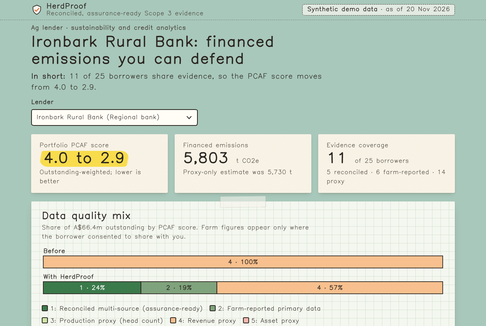
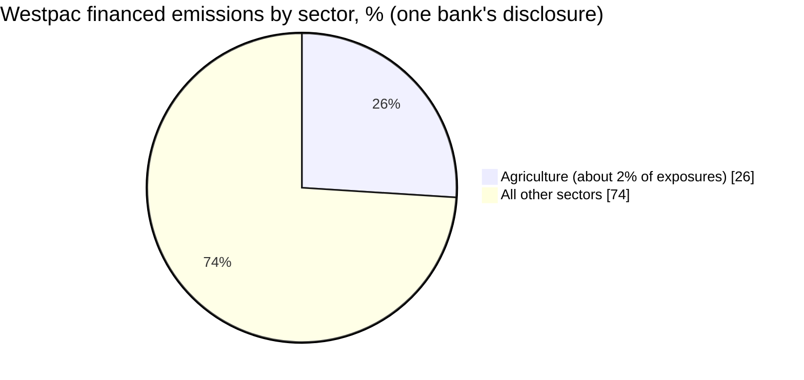
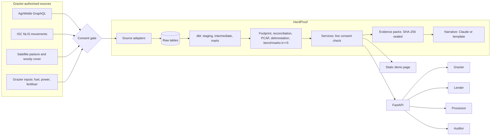
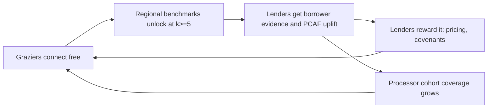
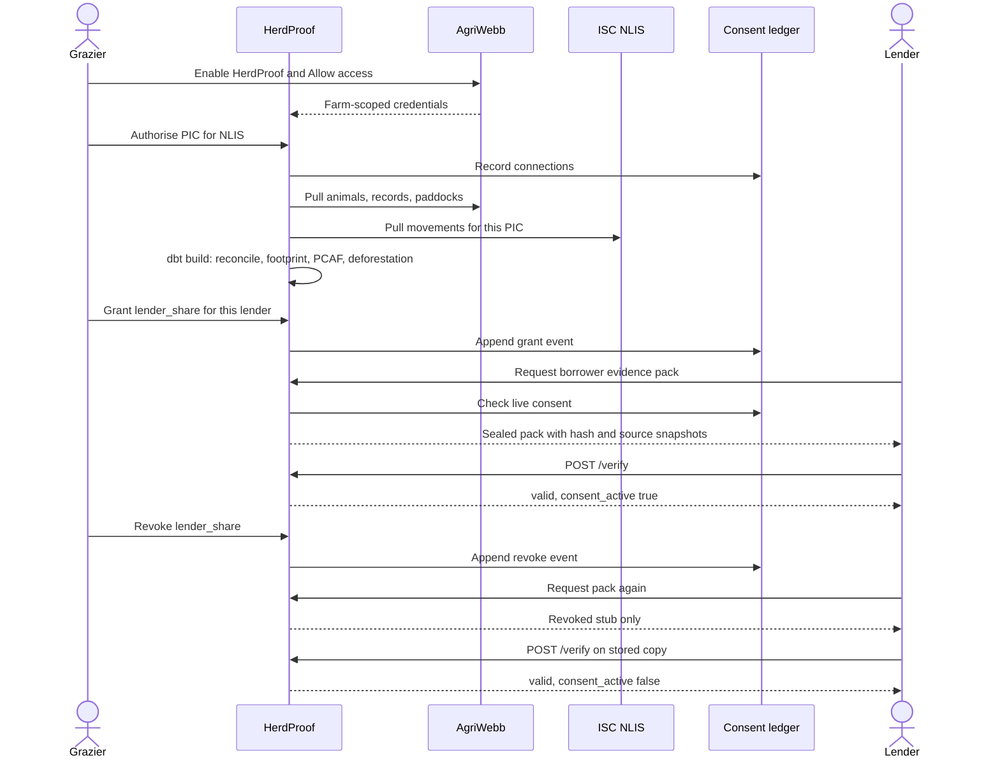
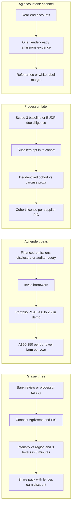
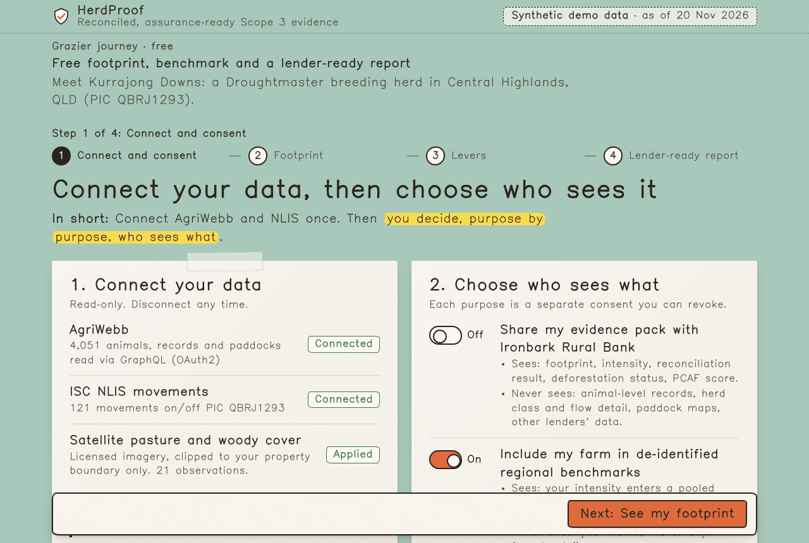
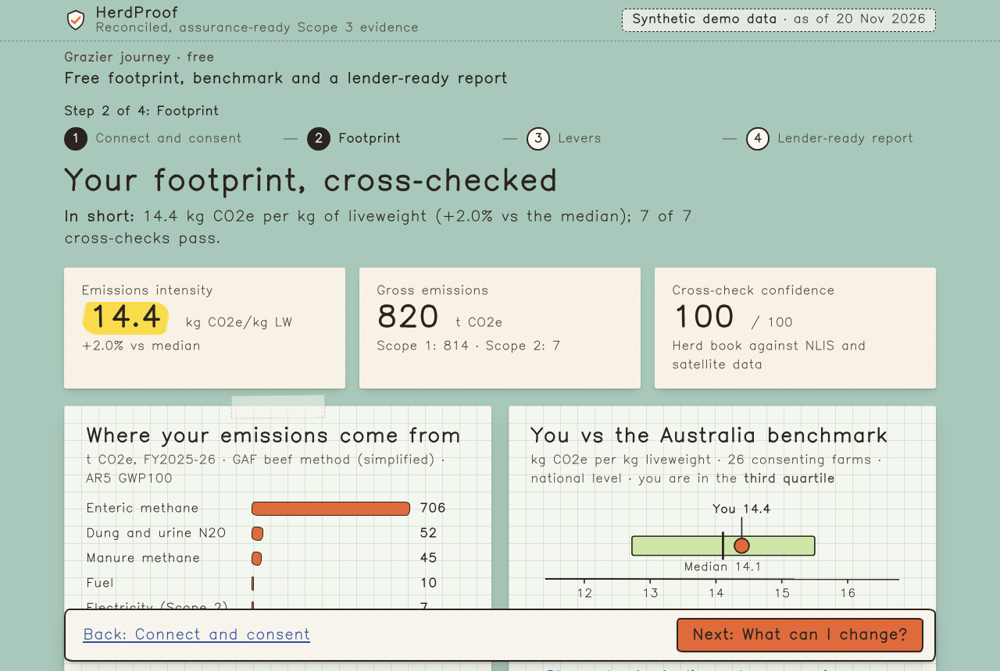
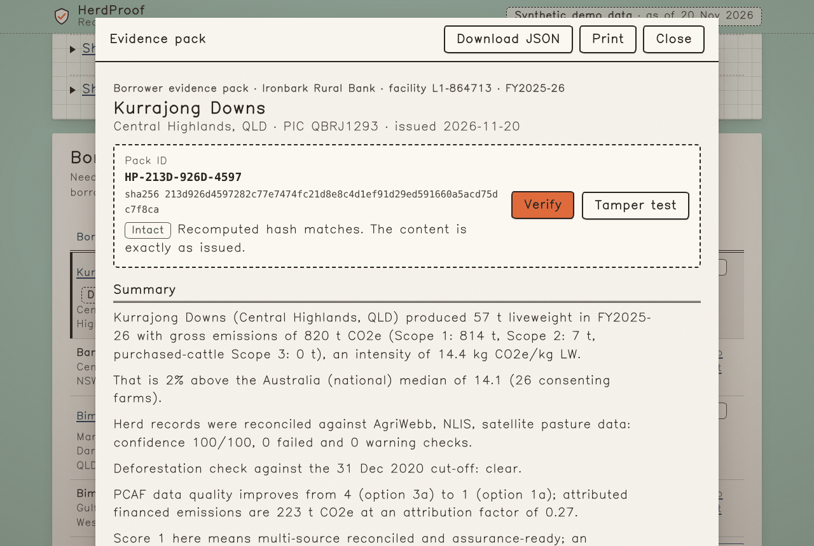
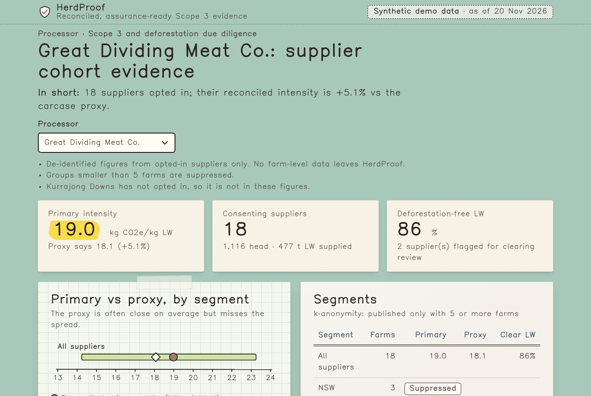

# HerdProof

**Lender-ready emissions evidence packs for bank review, built from cattle-farm data the grazier already has and chooses to share.**

HerdProof connects a grazier's AgriWebb herd records, ISC NLIS livestock movements and satellite pasture and woody-cover data, cross-checks them against each other, and turns the result into a sealed evidence pack that an ag lender can use for financed-emissions reporting and loan pricing. Graziers use it free. Lenders pay per borrower farm.

> **Status: working demo, not a product.** All farm data is synthetic. The emissions engine is a simplified, unofficial port of the GAF beef method. PCAF proxy factors are illustrative. See [What is real vs simulated](#what-is-real-vs-simulated).

[Interactive demo](demo/index.html) (single offline HTML file; GitHub shows its source, so download it and open it locally in a browser) · [Product brief](docs/PRODUCT_BRIEF.md) · [Quickstart](#quickstart)



---

## Contents

- [Background](#background)
- [The problem](#the-problem)
- [Who it is for](#who-it-is-for)
- [The solution](#the-solution)
- [Why now](#why-now)
- [How it works](#how-it-works)
- [Customer journeys](#customer-journeys)
- [Business model and revenue](#business-model-and-revenue)
- [Data sources and their validity](#data-sources-and-their-validity)
- [Demo walkthrough](#demo-walkthrough)
- [Quickstart](#quickstart)
- [Architecture and tech decisions](#architecture-and-tech-decisions)
- [Methodology and limitations](#methodology-and-limitations)
- [What is real vs simulated](#what-is-real-vs-simulated)
- [Why this might not work: what must be true](#why-this-might-not-work-what-must-be-true)
- [90-day plan](#90-day-plan)
- [Project layout](#project-layout)
- [License and attribution](#license-and-attribution)
- [Sources](#sources)

## Background

HerdProof tests a broader thesis: a **consented data-connection business**. People connect their own accounts through official APIs, get something useful for free, and businesses pay for services built on that data. The key lesson from the research is that **consent is not a licence to resell**. So HerdProof never sells farm data. It sells derived evidence: reconciled footprints, PCAF data-quality uplift, deforestation checks and sealed evidence packs.

HerdProof is one of several consent-API concepts explored, and it is not an easy one: the free footprint is already taken, demand has softened and farm-data supply sits behind one gatekeeper (details in [risks](#why-this-might-not-work-what-must-be-true)). The angle that survives is the **lender-side, multi-source evidence layer**, which is what this repo builds.

## The problem

Banks must now disclose financed emissions, and beef is where their numbers are concentrated.

- **Mandatory reporting has arrived.** Under ASRS / AASB S2, Group 1 entities report for financial years starting 1 Jan 2025, Group 2 from 1 Jul 2026 and Group 3 from 1 Jul 2027 ([ASIC](https://www.asic.gov.au/about-asic/news-centre/find-a-media-release/2024-releases/24-205mr-asic-urges-businesses-to-prepare-for-mandatory-climate-reporting/)). Scope 3, which includes financed emissions, is required from each entity's second reporting period ([Anthesis](https://www.anthesisgroup.com/au/regulations/asrs-aasb-s2/)). Modified liability for Scope 3 covers financial years starting 1 Jan 2025 to 31 Dec 2027. After that, Scope 3 figures carry normal liability and evidence quality starts to matter.
- **The exposure is concentrated.** At Westpac, agriculture is about 2% of committed exposures but about 26% of financed emissions, and about 80% of that comes from livestock. Lenders hold more than A$140B of agricultural credit, and banks supply about 93% of it.
- **The data cannot price a borrower.** Lenders estimate farm emissions from sector averages per dollar lent or earned, a PCAF data-quality score of 4 to 5. An average cannot show that one borrower is better than another. NAB offers a 1.15% rate discount on agribusiness finance that reduces emissions (CEFC-backed, announced Jan 2025), and pricing like that creates demand for farm-level evidence.
- **Buyers have the same gap.** About 98.5% of boxed-beef emissions sit in processors' Scope 3.
- **Graziers are tired of it.** They get repeated data requests, distrust anything labelled "carbon", and fear their data being resold.

One bank's disclosure, to show the concentration:



## Who it is for

| Persona | Job to be done | Pain today |
|---|---|---|
| **Grazier** (family cattle business, 300-5,000 head, uses AgriWebb) | Keep the bank happy, earn a loan discount, answer processor surveys once | Repeated data requests, distrust of "carbon", fear of data being resold |
| **Ag lender sustainability or credit analyst** (regional or mid-tier bank), first payer | Report financed emissions with defensible data quality and price climate risk per borrower | Sector proxies only, no way to verify borrower numbers, Scope 3 liability relief ends after FY2027 |
| **Processor sustainability lead** (Group 2) | Use supplier-specific primary data and support deforestation due diligence | Thousands of supplier PICs, carcase proxies only, no property-level deforestation evidence |
| **Ag accountant or advisor** (channel) | Bundle lender-ready emissions evidence with year-end accounts | No tooling, so the work is manual and unbillable |

## The solution

HerdProof is an evidence layer that sits between the grazier's systems and the lender. For each consenting borrower it:

1. **Reconciles** the AgriWebb herd book against independent sources: sales and purchases against NLIS movements, stocking rate against satellite pasture capacity, mapped area against the satellite boundary, and opening + births + purchases - sales - deaths = closing.
2. **Calculates** a GAF-consistent footprint and intensity (kg CO2e per kg liveweight produced).
3. **Scores** PCAF data quality before and after connecting: from sector proxy (5) to farm-reported (2), or multi-source reconciled with a clear land-use check (1, assurance-ready, not assured).
4. **Checks deforestation** against the 31 Dec 2020 cut-off using a woody-cover time series.
5. **Seals** everything into a SHA-256 evidence pack that a credit committee or auditor can re-verify, with a snapshot hash of every source row used.

Lenders see derived figures, flags and hashes. They never see animal-level records.

## Why now

| Signal | What it means |
|---|---|
| ASRS Group 2 started 1 Jul 2026; Group 3 starts 1 Jul 2027 | Mid-tier lenders and processors are entering mandatory reporting now |
| Scope 3 modified liability ends for FYs starting after 31 Dec 2027 | Proxy-quality financed emissions become a liability question |
| NAB 1.15% discount for agribusiness emissions reduction (Jan 2025) | Lenders are starting to price emissions performance |
| Free calculators are everywhere ([AgriWebb GAF calculator](https://help.agriwebb.com/en/articles/11846390-greenhouse-accounting-framework), [AIA engine maintained to June 2028](https://github.com/aginnovationaustralia/emissions-calculators), [CSIRO FarmPrint, Feb 2026](https://www.csiro.au/en/news/All/News/2026/February/CSIRO-unveils-new-tool-to-help-farmers-measure-environmental-footprint)) | The footprint is a commodity. Evidence a lender can rely on is not |

## How it works

### Architecture



### Data flywheel



The moat is the consented connection graph plus a reconciliation history over time, not the calculator.

### Connect, consent, reconcile, share, revoke



## Customer journeys



## Business model and revenue

Graziers never pay. The first payer is a regional or mid-tier ag lender, reached through ag accountants who already sit with graziers at year end. **All prices below are hypotheses to test in the pilot, not validated numbers.**

| Payer | What they buy | Price hypothesis | Illustration |
|---|---|---|---|
| Grazier | Footprint, benchmark, levers, lender-ready report | Free | Drives connections |
| Regional / mid-tier ag lender (first payer) | Evidence packs, PCAF scoring, portfolio view | A$50-150 per borrower farm per year (pilot go threshold A$75) | 1,000 connected borrowers at A$100 = A$100k ARR |
| Processor (later) | De-identified supplier cohort, deforestation share | Cohort licence per supplier PIC covered | To be priced after lender traction |
| Ag accountant (channel) | Bundled lender-ready emissions evidence for clients | Referral fee or white-label margin | Distribution, not core revenue |

The arithmetic is honest about scale: per-farm pricing needs thousands of connected farms to become a venture-scale business, which is why the flywheel and the processor cohort matter.

## Data sources and their validity

Checked 20 Nov 2026.

| Source | What HerdProof needs | Access path | Status |
|---|---|---|---|
| **AgriWebb API** | Animals, weigh/birth/sale/death records, paddocks | GraphQL API and Reports API (CSV). Every credential is issued by AgriWebb staff (API key or Marketplace partner registration). The farmer enables each farm with "Allow access" | Real and documented. **Partner terms on reuse and aggregation are not public** and must be negotiated |
| **ISC NLIS / eNVD** | Movements on and off the consenting PIC | ISC's 7-step process ([ISC API](https://www.integritysystems.com.au/about/api/)): register on the Developer Portal and ISC approves, sandbox development, access application, assessment, signed agreement, then production credentials. SOAP, REST and GraphQL per the Developer Portal | Real, gated. Movement payload is not published, so the demo models it |
| **Cibo Labs** (satellite) | 5-day pasture biomass, ground cover, woody cover | Available inside AgriWebb with a Performance subscription plus a paid Pasture Key ([AgriWebb help](https://help.agriwebb.com/en/articles/3245061-cibolabs-integration)); Farm Reports listed at $165 each ([Cibo Labs](https://www.cibolabs.com.au/products)) | Real data, but **no public API verified** for third-party evidence packs. Needs a commercial licence |
| **Digital Earth Australia** (fallback) | Sentinel-2 imagery to derive pasture and woody indices | Public open data (Cibo itself builds on it) | Viable fallback; HerdProof would compute its own indices |
| **AIA emissions-calculators** | GAF-consistent beef footprint | Open source, CC BY 4.0 (npm engine, EAP API) | Demo uses a simplified, unofficial SQL port. Production should call AIA's engine |

Links: [AgriWebb docs](https://docs.agriwebb.com) · [AgriWebb API report card](https://supergood.ai/api-report-card/agriwebb) · [AgriWebb Marketplace](https://help.agriwebb.com/en/articles/6976821-agriwebb-marketplace) · [ISC API](https://www.integritysystems.com.au/about/api/) · [ISC Developer Portal](https://developer.integritysystems.com.au/get-started) · [Cibo Labs in AgriWebb](https://help.agriwebb.com/en/articles/3245061-cibolabs-integration) · [Cibo Labs products](https://www.cibolabs.com.au/products) · [DEA pasture data](https://www.ga.gov.au/scientific-topics/dea/news/data-for-pasture-productivity) · [AIA emissions-calculators](https://github.com/aginnovationaustralia/emissions-calculators)

## Demo walkthrough

`demo/index.html` is one self-contained file with the backend's output embedded. It runs offline with no server. Switch personas from the header.

**1. Grazier connects and chooses who sees what.** Simulated AgriWebb authorisation, PIC link for NLIS, then a separate, revocable consent per purpose, with a plain-language "sees / never sees" list.



**2. Grazier sees a footprint that has been cross-checked.** Emission sources, intensity against the most local published benchmark (give-to-get; in the demo data complementary suppression withholds regions and states, so it is national), and seven reconciliation checks against NLIS and satellite data.



**3. Lender sees portfolio data quality move.** Outstanding-weighted PCAF score before and after (4.0 to 2.9 here, because the page includes the hero farm's simulated sharing grant; the live API shows 4.0 to about 3.06 with 10 of 25 sharing), financed emissions, the data-quality mix and borrowers needing attention. Farm figures appear only for consenting borrowers.


**4. Lender opens and verifies an evidence pack.** The browser recomputes the same canonical-JSON SHA-256 the Python backend computes. **Tamper test** edits one number and shows the hash failing. Print and Download JSON work when the file is opened locally; inside sandboxed previews the page shows a short note instead.



**5. Processor sees a de-identified supplier cohort.** Primary intensity against the carcase proxy, the supplier spread, the deforestation-free share of liveweight, and k-anonymity suppression with complementary suppression.



The **How it works** and **Why HerdProof** tabs cover the architecture, consent model, competitor comparison and risks.

## Quickstart

Requires [uv](https://docs.astral.sh/uv/). uv installs a matching Python (3.12 or 3.13) automatically.

**Windows (PowerShell)**

```powershell
# Install uv once (see https://docs.astral.sh/uv/getting-started/installation/)
powershell -ExecutionPolicy ByPass -c "irm https://astral.sh/uv/install.ps1 | iex"

git clone https://github.com/HanL1223/herdproof
cd herdproof

uv sync                        # dbt-core, dbt-duckdb, DuckDB, FastAPI
uv run herdproof build         # generate fixtures, ingest consented sources, dbt build (~20 s)
uv run herdproof export-demo   # rebuild demo\index.html with fresh data
start demo\index.html          # works offline

uv run herdproof serve         # API docs at http://127.0.0.1:8000/docs

# In a second terminal
Invoke-RestMethod http://127.0.0.1:8000/health
Invoke-RestMethod http://127.0.0.1:8000/lenders/L1/portfolio -Headers @{ "X-Demo-Principal" = "lender:L1" }
```

**macOS / Linux**

```bash
# Install uv once (see https://docs.astral.sh/uv/getting-started/installation/)
curl -LsSf https://astral.sh/uv/install.sh | sh

git clone https://github.com/HanL1223/herdproof
cd herdproof
uv sync
uv run herdproof build
uv run herdproof export-demo
open demo/index.html            # Linux: xdg-open demo/index.html

uv run herdproof serve
# In a second terminal
curl http://127.0.0.1:8000/health
curl -H "X-Demo-Principal: lender:L1" http://127.0.0.1:8000/lenders/L1/portfolio
```

**Other commands**

```bash
uv run herdproof pack --farm F002 --lender L1 --out pack.json   # lender pack (needs lender_share consent)
uv run herdproof pack --farm F001 --out report.json             # grazier report
uv run herdproof verify pack.json                               # exit code 1 if tampered
uv run herdproof build --skip-generate                          # re-ingest and re-model only
```

`build` writes fixtures, landing files and the DuckDB warehouse to `data/`, which is not committed: it is reproducible from the seed (`HERDPROOF_SEED`). Stop `serve` before `build`, which recreates the DuckDB file. `demo/index.html` is committed and byte-identical across rebuilds.

The live API shows Ironbark's PCAF score moving 4.0 to about 3.06 (10 of 25 borrowers sharing). The demo page shows 2.9 (11 sharing) because it includes the hero farm's simulated sharing grant from the grazier walkthrough.

**Optional AI narratives.** `uv sync --extra ai`, then set `ANTHROPIC_API_KEY` (PowerShell: `$env:ANTHROPIC_API_KEY="..."`). `HERDPROOF_LLM_MODEL` overrides the default model. Without a key, or if a call fails, narratives come from deterministic templates.

### API

Every route except `/health` and `/verify` needs a demo principal header, for example `X-Demo-Principal: lender:L1`.

| Method | Path | Purpose |
|---|---|---|
| GET | `/connect/{source}/callback?farm_id&code` | Mock AgriWebb authorisation or NLIS PIC link |
| GET, POST, DELETE | `/farms/{id}/consents[/{purpose}]` | List, grant and revoke purpose-bound consents |
| GET | `/farms/{id}/consents/history` | Append-only grant and revoke events |
| GET | `/farms/{id}`, `/farms/{id}/footprint`, `/levers`, `/reconciliation`, `/deforestation`, `/report` | Grazier's own results and sealed report |
| GET | `/benchmarks` | Published benchmarks (consented farms only, k >= 5 with complementary suppression) |
| GET | `/lenders/{id}/portfolio` | PCAF before and after; farm figures only for consenting borrowers |
| POST | `/lenders/{id}/borrowers/{farm}/evidence-pack` | Issue a lender pack; **403** without `lender_share:{id}` consent |
| GET | `/packs/{pack_id}` | Fetch a pack; a revoked lender pack returns a `{"status": "revoked"}` stub |
| POST | `/verify` | Recompute the hash, check the registry and whether consent is still active |
| GET | `/processors/{id}/cohort` | De-identified supplier cohort (suppressed below k = 5) |

## Architecture and tech decisions

| Decision | Why |
|---|---|
| **dbt-core + dbt-duckdb**, Snowflake-portable SQL | Runs on a laptop in seconds with no cloud account. Models use dbt cross-database macros, `QUALIFY`, `percentile_cont ... within group` and `* exclude`, all supported by Snowflake, so production is a profile swap to `dbt-snowflake`. Lineage gives an auditor a readable path from source row to number |
| **Source adapters** behind one `SourceAdapter` contract | Each source lands typed raw tables per consented farm. The demo uses a `FixtureTransport` that replays recorded payloads; production swaps in an HTTP transport without touching models |
| **Append-only consent ledger** | Grants and revocations are events, never updates, so "who could see what, when" is provable. Lender reads check the live ledger; benchmarks and cohorts apply consent at each rebuild |
| **Purpose-bound consents with scopes** | Connecting a source only lets HerdProof compute the grazier's own results. `lender_share:<lender>`, `regional_benchmark` and `processor_cohort` are separate, with scopes (`footprint`, `reconciliation`, `deforestation`, `herd_detail`). Designed to align with the [Australian Farm Data Code](https://nff.org.au/programs/australian-farm-data-code/) and Privacy Act APPs 3, 6 and 11 |
| **k-anonymity with complementary suppression** | Benchmarks and cohorts publish only at k >= 5. A level (benchmark regions, benchmark states, a processor's state segments) publishes only if every segment in it clears k, so a small segment cannot be derived by subtraction from its siblings and the parent total. P25-P75 needs 10 or more farms. In the demo data this leaves only the national benchmark published |
| **SHA-256 sealed packs with source snapshots** | Canonical JSON hash plus a hash of the exact raw rows each source contributed. Anyone can re-verify, including in the browser |
| **Demo-principal auth stub** | `X-Demo-Principal` demonstrates the access rules (a farm sees only itself, a lender only its borrowers). It is not authentication; production would use OAuth2 / Cognito |
| **AI layer with offline fallback** | An LLM only rewrites facts already in the pack and never computes numbers. Without a key, templates produce the narrative, so the demo always runs offline |
| **Python entry points, no shell scripts** | One `herdproof` CLI works the same on Windows and Unix |

**Path to production (sketch, AWS ap-southeast-2):** API Gateway + ECS Fargate for this FastAPI app; Cognito for grazier, lender and processor tenants; Aurora PostgreSQL for the consent ledger and pack registry; EventBridge + Step Functions running adapters, with tokens in Secrets Manager; S3 landing in Parquet; Snowflake via Snowpipe with the same dbt project; KMS asymmetric keys to sign packs on top of the hash; Claude via Amazon Bedrock to keep farm data onshore; AIA's engine for footprints. Satellite: a licensed provider such as Cibo Labs if per-property derived use can be licensed, otherwise indices computed from DEA Sentinel-2 public data.

## Methodology and limitations

- **Engine.** Core GAF beef Scope 1 equations ported to SQL from AIA's emissions-calculators v3.0.2 (`fct_farm_footprint`): dry-matter intake (Minson and McDonald), enteric CH4 at 20.7 g/kg DMI, manure CH4, faecal and urinary N2O with IPCC-default indirect fractions, plus fertiliser, urea, lime, fuel, state Scope 2 electricity and purchased cattle. GWP is AR5 (CH4 28, N2O 265). The port is unofficial and not validated by AIA. Node was kept out of the runtime, and AIA asks integrators not to alter its logic, so production should call AIA's engine and keep the SQL port for reconciliation and what-ifs.
- **Simplifications.** Seasons are FY quarters; calves under 200 days are excluded and replaced by a cow lactation uplift; diet quality by zone and season is approximate; plantings use a flat sequestration rate; northern-herd parameters are illustrative.
- **Intensity.** (Scope 1 + 2 + purchased-cattle Scope 3) / liveweight produced, where liveweight produced = sold - purchased + closing - opening.
- **Reconciliation.** Seven weighted checks (seed `ref_reconciliation_checks`). Confidence is the weighted score over checks that could be assessed; thresholds are heuristic.
- **PCAF (business loans).** Baseline is option 3b, 3a or 2b depending on what the lender holds. Connected farms score 2 (1b); they score 1 (1a) only when all three sources are assessed, confidence is at least 75 and the deforestation check is clear. **PCAF 1a needs third-party verification**: HerdProof supplies the evidence trail, an assurer signs. Financed emissions attribute Scope 1 + 2 only, using outstanding / total assets. **Proxy factors are illustrative**, roughly right on average and wrong per farm.
- **Deforestation.** Baseline woody area at 31 Dec 2020. "Review" if a later observation falls more than max(10 ha, 2% of baseline) below it; "insufficient data" with fewer than 3 post-cut-off observations. Review is not fail, because clearing can be lawful. Australia is rated EUDR low risk, so this is due-diligence support, not a mandate.
- **Benchmarks.** Consenting farms only. Each farm is compared with the most local published level (region, then state, then national), under the suppression rules above.
- **Levers.** First-order what-ifs on the farm's own numbers, indicative only.

Full detail and the consent model are in [`docs/PRODUCT_BRIEF.md`](docs/PRODUCT_BRIEF.md).

## What is real vs simulated

| Component | Status |
|---|---|
| Warehouse, models, reconciliation, PCAF, deforestation, benchmarks | **Real** dbt-core + dbt-duckdb logic |
| Consent ledger, evidence packs, hashing, verification, revocation | **Real** logic |
| FastAPI service and access rules | **Real**, with a **demo auth stub** |
| LLM narratives | **Real** Anthropic client when a key is set; templates otherwise |
| Farm, lender and processor data | **Synthetic**: seeded generator, 56 farms in QLD, NSW, VIC and NT, 41 connected, about 22k animals and 113k records, with deliberate NLIS mismatches, phantom animals, unrecorded sales, under-mapped paddocks, post-2020 clearing and cloud gaps |
| AgriWebb payloads | **Mocked fixtures** shaped from AgriWebb's public GraphQL docs. Exact query argument signatures still need checking in the API playground |
| NLIS movements | **Mocked**; field names are modelled because the payload is not published |
| Satellite data | **Mocked**, provider-agnostic |
| AgriWebb authorisation | **Simulated** dialog and callback endpoint |
| Emission factors, PCAF proxies | Footprint constants from AIA; **PCAF proxies illustrative** |

## Why this might not work: what must be true

The honest case against HerdProof, and the conditions it needs:

- **The free wedge is taken.** AgriWebb has a built-in GAF calculator, AIA's engine is free and maintained to June 2028, CSIRO FarmPrint launched in Feb 2026, and Ruminati is inside AgriWebb with CBA and Rabobank pilots. AMPC found carcase-data proxies close to verified footprints on average (11.7 vs 11.4 kg CO2e/kg). HerdProof cannot win on the footprint.
- **Demand has softened.** The red meat industry dropped its CN30 target in Jun 2025, and the ACCU beef herd management method closed to new projects on 30 Sep 2025.
- **Supply has one gatekeeper.** AgriWebb issues every credential and its partner reuse terms are not public. AgriWebb covered more than 15% of the national herd (about 30.4M head across 53,964 cattle businesses) in 2022, so most graziers would need another path anyway.

What must be true:

1. **AgriWebb approval** with terms that allow computing from the data and sharing derived results with a grazier-nominated lender (benchmarks need their own right). This is the largest dependency.
2. **An ISC NLIS licence**, with queries scoped to the consenting PIC.
3. **A lender pays.** At least one regional or mid-tier lender values PCAF uplift enough to pay per farm. Fallback buyer: a Group 2 processor.
4. **Assurers accept multi-source reconciliation** as evidence for limited assurance, or HerdProof partners with one.
5. **Proxies stay "not good enough"** for borrower-level pricing. If proxies are accepted at PCAF 2, the thesis weakens.
6. **Satellite rights**: a commercial licence that allows derived outputs in packs, or a DEA-based pipeline lenders accept.

## 90-day plan

| Weeks | Goal | Done when |
|---|---|---|
| 1-4 | **Access and demand** | AgriWebb partner conversation opened and ISC Developer Portal registration submitted; 5 regional or mid-tier lenders and 10 ag accountants interviewed with this demo; DEA Sentinel-2 woody-cover prototype on 3 real properties |
| 5-8 | **Pilot design** | One lender LOI for a 30-borrower pilot; an assurance provider reviews the pack format and reconciliation thresholds; price points of A$75, A$100 and A$150 per farm per year tested |
| 9-12 | **Pilot run and decision** | Measured against the success metrics below; go or no-go against the other concepts |

Pilot success (one lender, 90 days):

- At least 30 borrower farms connected, with at least 60% of invited borrowers connecting within 30 days.
- Portfolio-weighted PCAF score improves by at least 1.5 points across pilot borrowers.
- At least 80% of packs reach reconciliation confidence of 70 or more; every flag is reviewed and confirmed or explained.
- An assurance provider agrees in writing that the packs are suitable evidence for limited assurance.
- A signed LOI or paid pilot at A$75 or more per farm per year, with a named product use such as loan pricing or the disclosure note.

**Kill criteria:** no lender commits at A$75 or more per farm per year, or no credible path to AgriWebb and ISC access, within 90 days.

## Project layout

```
docs/
  PRODUCT_BRIEF.md          problem, personas, consent model, flywheel, journeys, risks, data sources
  images/                   README screenshots
src/herdproof/
  cli.py                    `herdproof` entry point: build, export-demo, serve, pack, verify
  config.py                 paths and settings (HERDPROOF_* environment variables)
  synth.py                  seeded synthetic farms, herds, NLIS, satellite and lenders
  adapters/                 SourceAdapter contract plus AgriWebb, NLIS and satellite adapters
  ingest.py                 consent-gated extract-load into DuckDB raw tables
  consent.py                append-only, purpose-bound consent ledger
  transform.py              runs `dbt build` in a child process
  services.py               read model over marts; lender reads check live consent
  levers.py                 quantified improvement levers
  evidence.py               evidence packs: assemble, snapshot-hash, seal, verify, register
  narrative.py              LLM writer with deterministic template fallback
  api.py                    FastAPI service
  export.py                 embeds backend output into the demo template
  web/index.html            demo template (inline CSS and JS, hand-rolled SVG, no network)
warehouse/                  dbt project: seeds, staging, intermediate, marts, macros
demo/index.html             built, self-contained demo (about 275 KB)
NOTICE                      third-party attribution (AIA, CC BY 4.0)
```

## License and attribution

Copyright (c) 2026 Han Li. Proprietary: you may view the code and run the demo to evaluate it; copying, redistribution and commercial use need written permission. See [`LICENSE`](LICENSE).

Parts of the footprint model and emission-factor seeds are adapted from the **AIA Environmental Accounting Platform emissions-calculators** (Agricultural Innovation Australia), licensed under [CC BY 4.0](https://creativecommons.org/licenses/by/4.0/); those adapted parts remain under CC BY 4.0. This is an unofficial derivative, not reviewed or validated by AIA. Changes are listed in [`NOTICE`](NOTICE).

The demo page's visual style and its embedded Kevin Sans font come from [Looseleaf](https://github.com/kevintngo/looseleaf) by Kevin T. Ngo, MIT License; see [`NOTICE`](NOTICE).

Farm, lender and processor names in the demo are fictional.

## Sources

- ASIC reporting groups and start dates: https://www.asic.gov.au/about-asic/news-centre/find-a-media-release/2024-releases/24-205mr-asic-urges-businesses-to-prepare-for-mandatory-climate-reporting/
- Scope 3 from second reporting period (Anthesis): https://www.anthesisgroup.com/au/regulations/asrs-aasb-s2/
- ASRS Scope 3 modified liability (BDO): https://www.bdo.com.au/en-au/insights/esg-sustainability/asic-provides-guidance-on-the-modified-liability-settings-for-mandatory-sustainability-reporting
- Westpac 2% / 26% / ~80%: https://bankingday.com/westpac-takes-on-herd
- Ag credit >A$140B, banks ~93%: https://www.ausbanking.org.au/wp-content/uploads/2025/11/254512-Agri-report_WEB.pdf
- NAB 1.15% emissions-reduction discount: https://www.nab.com.au/news/business-banking/nab-cefc-discount
- AMPC 98.5% and 11.7 vs 11.4: https://ampc.com.au/media/o3zmlbzz/ampc-showcase-3-things-about-scope-3-publish.pdf
- MLA beef fast facts 2025 (53,964 cattle businesses; 30.4M head, Jun 2024): https://www.mla.com.au/globalassets/mla-corporate/prices--markets/documents/trends--analysis/fast-facts--maps/mla_beef-fast-facts-2025_301025.pdf
- AgriWebb >15% of national herd (Oct 2022): https://techcrunch.com/2022/10/10/agriwebbs-software-seeks-to-boost-yields-lower-environmental-impacts-for-farmers-and-ranchers/
- AgriWebb GAF calculator: https://help.agriwebb.com/en/articles/11846390-greenhouse-accounting-framework
- CSIRO FarmPrint launch (24 Feb 2026): https://www.csiro.au/en/news/All/News/2026/February/CSIRO-unveils-new-tool-to-help-farmers-measure-environmental-footprint
- AIA emissions-calculators (CC BY 4.0, maintained to June 2028): https://github.com/aginnovationaustralia/emissions-calculators
- AIA free EAP access, grant to June 2028: https://www.agriculture.gov.au/agriculture-land/farm-food-drought/climatechange/greenhouse-gas-accounting/grant-program
- Australian Farm Data Code (NFF): https://nff.org.au/programs/australian-farm-data-code/
- Ruminati CBA pilot: https://commbank.com.au/articles/newsroom/2024/02/cba-emissions-calculator-ruminati.html
- Rabobank: https://www.rabobank.com.au/media-releases/2024/cultivating-clarity-understanding-emissions-basics-increasingly-important-for-Australias-farm-sector
- CN30 dropped: https://www.beefcentral.com/news/aus-red-meat-sector-drops-carbon-neutral-2030-target/
- ACCU beef cattle herd management method: https://cer.gov.au/schemes/australian-carbon-credit-unit-scheme/accu-scheme-methods/beef-cattle-herd-management-method
- EUDR application 30 Dec 2026: https://www.addleshawgoddard.com/en/insights/insights-briefings/2026/retail-consumer/eu-deforestation-regulation-final-countdown-to-application-30-december-2026/
- EC rates Australia low risk: https://www.beefcentral.com/news/european-commission-declares-australia-low-risk-for-deforestation/
- Data-source links: see [Data sources and their validity](#data-sources-and-their-validity)
