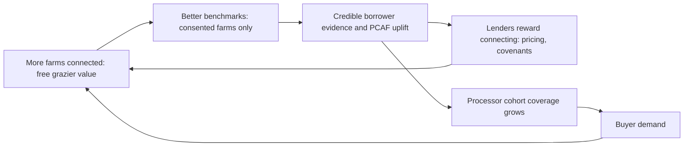

# HerdProof — Product Brief (demo v0.1, 20 Nov 2026)

> Consented herd and land data that turns Australian cattle graziers' records into **reconciled, assurance-ready (not assured) Scope 3 evidence packs for lender review**, for ag lenders and beef buyers.

## Background: why this exists

HerdProof tests a broader thesis: a **consented data-connection business**. Users connect their own accounts through official APIs, get something useful for free, and businesses pay for services built on that data. The key finding from the research is that **consent is not a licence to resell**. So HerdProof never sells farm data. It sells derived evidence: reconciled footprints, PCAF-style data-quality uplift, deforestation checks and sealed evidence packs.

HerdProof is one of several consent-API concepts explored, and it is not an easy one: the free footprint is already taken (AgriWebb's GAF report, AIA's engine, CSIRO FarmPrint, Ruminati), demand softened (the industry dropped CN30 in Jun 2025; the ACCU beef herd management method closed to new projects on 30 Sep 2025), and farm-data supply sits behind one gatekeeper (AgriWebb). The angle that survives is the **lender-side, multi-source evidence layer**, which is what this demo builds.

## 1. The problem

Banks must now report financed emissions, and beef is where the numbers are.

- **The rules have arrived.** Under ASRS / AASB S2, Group 1 entities report for financial years starting 1 Jan 2025. Group 2 follows from 1 Jul 2026 and Group 3 from 1 Jul 2027 (ASIC). Scope 3, which includes financed emissions, is required from each entity's second reporting period. Modified liability covers Scope 3 statements in reports for financial years starting 1 Jan 2025 to 31 Dec 2027; after that, Scope 3 figures carry normal liability, so their evidence quality matters more.
- **The exposure is concentrated.** Westpac reports that agriculture is ~2% of its committed exposures but ~26% of its financed emissions, ~80% of which comes from livestock. Lenders hold more than A$140B of agricultural credit (Sep 2025), and banks supply ~93% of rural finance.
- **The data is poor.** Lenders mostly estimate borrower emissions from sector averages: emission factors per dollar lent or earned. In PCAF terms that is a data-quality score of **4–5**. A sector average cannot show that one borrower is better than another, so it cannot support pricing. NAB offers a 1.15% rate discount on agribusiness finance that reduces emissions (CEFC-backed, announced Jan 2025); pricing like that creates demand for farm-level evidence.
- **The buyer side looks the same.** About 98.5% of boxed-beef emissions sit in processors' Scope 3. EUDR applies from 30 Dec 2026 with a 31 Dec 2020 cut-off. Australia is rated low risk, so EU importers run simplified due diligence (geolocation and information still required, no risk assessment). Property-level deforestation evidence is therefore buyer and lender due-diligence support, not a hard mandate.

**Why a free calculator is not the business.** Graziers can already get a footprint for free. AgriWebb has a built-in GAF calculator. AIA's open-source engine is free (CC BY 4.0) and maintained until June 2028. CSIRO FarmPrint launched in Feb 2026. Ruminati is integrated with AgriWebb and running pilots with CBA and Rabobank. AMPC found that carcase-data proxies come close to verified farm footprints (11.7 vs 11.4 kg CO2e/kg). So **the footprint is a commodity. What is scarce is evidence that a lender or auditor can rely on.**

## 2. Product thesis and defensible angle

HerdProof is a **lender-side, multi-source evidence layer**. For each borrower it:

1. **Reconciles** herd records (AgriWebb), NLIS livestock movements (ISC) and satellite pasture and woody-cover data. It checks the herd book against independent sources: sales and purchases against NLIS, stocking rate against pasture capacity, and opening + births + purchases − sales − deaths = closing.
2. **Calculates** a GAF-consistent footprint and intensity. The demo uses a simplified port; production would use the AIA engine.
3. **Scores** PCAF data quality before and after connection: from sector proxy (5) up to farm-reported (2), or multi-source reconciled with a clear land-use check and assurance-ready (1†).
4. **Checks deforestation** against a 31 Dec 2020 cut-off (the EUDR date) using a woody-cover time series.
5. **Packages** the result as a **hash-verifiable evidence pack** that an auditor or credit committee can verify independently.

† PCAF option 1a requires emissions verified by a third party. HerdProof provides the reconciled evidence trail that makes a limited-assurance engagement cheap. It does not certify the emissions itself.

## 3. Personas

| Persona | Job to be done | Pain today |
|---|---|---|
| **Grazier** (family cattle business, 300–5,000 head, uses AgriWebb) | Keep the bank happy, get the sustainability-linked loan discount, answer processor surveys once | Gets repeated data requests, distrusts "carbon", fears data being resold |
| **Ag lender sustainability / credit analyst** (regional or mid-tier bank) | Report financed emissions with defensible data quality and price climate risk per borrower | Has sector proxies only, no way to verify borrower-supplied numbers, and faces audit exposure from FY27 |
| **Processor sustainability lead** (Group 2, preparing FY2027–28 Scope 3) | Use supplier-specific primary data and support deforestation due diligence | Holds thousands of supplier PICs, has carcase proxies only, and has no deforestation evidence |
| **Ag accountant / advisor** (channel) | Bundle "lender-ready emissions evidence" with year-end accounts | No tooling, so the work is manual and unbillable |

## 4. Customer journeys (trigger → value moment → paid moment)

- **Grazier.** *Trigger:* the bank's annual review or a processor supplier survey. *Value moment:* within 5 minutes of connecting AgriWebb and the NLIS PIC, sees their intensity against the regional benchmark and three quantified improvement levers. *Paid moment:* none, because it is free for graziers. The grazier's payoff is the lender discount, earned by sharing the reconciled pack.
- **Lender.** *Trigger:* first Scope 3 / financed-emissions disclosure, an auditor query about data quality, or the design of a sustainability-linked loan product. *Value moment:* the portfolio view shows the weighted PCAF score moving down from sector-proxy levels as borrowers connect (demo page, which includes the hero farm's simulated grant: Ironbark 4.0 → 2.9 with 11 of 25 borrowers sharing; the live API without that grant shows 4.0 → 3.06 with 10; Riverbend 3.32 → 2.05), with reconciliation flags and deforestation status per borrower. *Paid moment:* A$50–150 per borrower farm per year for evidence packs, PCAF scoring and the portfolio view.
- **Processor.** *Trigger:* Scope 3 baseline, EUDR due diligence, or a retailer request. *Value moment:* a de-identified supplier cohort intensity compared with carcase proxies, plus a deforestation-risk share. *Paid moment:* a cohort licence, priced per supplier PIC covered. This is later-stage.
- **Accountant (channel).** Offers the connection as part of year-end work and earns a referral fee or a white-label margin.

## 5. MVP functional requirements

1. **Connect and consent.** The grazier connects AgriWebb (OAuth2 auth-code, Marketplace partner) and links their PIC for NLIS (ISC licensed API). They then grant **purpose-specific** consents: share with lender X, include in regional benchmark, include in processor cohort (de-identified). Each consent can be revoked at any time.
2. **Ingest** through source adapters with a common interface, landing raw data to the warehouse. Only farms with a connection consent are ingested.
3. **Model** the data in layered dbt models (staging → intermediate → marts): herd class × season, herd flows, footprint, reconciliation, deforestation, PCAF score, financed emissions, benchmarks and cohorts.
4. **Footprint and intensity** using the GAF beef method: enteric CH4, manure CH4 and N2O, fertiliser, fuel, electricity, purchased-cattle Scope 3, and sequestration from plantings. Intensity is reported as kg CO2e per kg liveweight produced.
5. **Reconciliation engine** that flags discrepancies across sources and produces a confidence score from 0 to 100.
6. **PCAF score** per borrower, before and after connection, with financed emissions calculated as attribution factor × farm emissions.
7. **Deforestation check** of woody-cover loss after 31 Dec 2020, with status *clear*, *review* or *insufficient data*.
8. **Evidence packs** (lender pack and grazier report) with a content-hash ID and a public verify endpoint. The narrative is written by an LLM when one is configured and by deterministic templates otherwise.
9. **Lender portfolio** showing financed emissions, the PCAF mix and flags. Farm-level detail appears only for borrowers who have consented to share with that lender.
10. **Processor cohort** showing aggregated data only, with k-anonymity (k ≥ 5) and complementary suppression.

**Non-goals for the MVP:** carbon credits or ACCUs (the beef herd management method closed to new projects on 30 Sep 2025; existing projects keep crediting), certifying emissions ourselves, selling or brokering data, feedlot, sheep or dairy enterprises, and on-farm data entry beyond a short inputs form for fuel, fertiliser and electricity.

## 6. Consent and data-rights model (hard constraint: consent ≠ resale)

- **Purpose-bound consents** are recorded in a ledger that stores the farm, the purpose (`lender_share:<lender>`, `regional_benchmark`, `processor_cohort`), the data scopes, and the grant and revoke timestamps. Grants and revocations are append-only events. Lender reads (portfolio, borrower detail, pack issue and retrieval) check the live ledger; benchmarks and cohorts apply consent at each rebuild.
- **Source connections are not data-sharing consents.** Connecting AgriWebb lets HerdProof compute the grazier's own footprint and nothing more. Sharing with a lender requires a separate consent for each lender.
- **Benchmarks and cohorts** only include farms that opted in. They are published only where k ≥ 5 farms, with complementary suppression: a level (regions, states, a processor's state segments) publishes only if every segment in it meets k, and P25–P75 needs 10 or more farms. Otherwise the farm is compared at the next published level (region, then state, then national).
- **Raw farm data is never sold, never shared raw, and never used to train models.** Lenders receive derived evidence such as figures, flags and hashes, not animal-level records.
- **Alignment.** The model follows the Australian Farm Data Code (transparency, consent, control, portability, security), the Privacy Act (APP 3, 6 and 11), the AgriWebb Marketplace terms and the ISC NLIS API licence. Revoking a consent stops future sharing. Evidence packs already issued remain hash-verifiable, but HerdProof stops serving their content and reports consent as revoked.

## 7. The data flywheel

The moat is the consented connection graph plus a reconciliation history over time. The calculator is not the moat.

## 8. Selling points by buyer, against the alternatives

From public information, Nov 2026 (sources below).

| | AgriWebb GAF report | Ruminati | CSIRO FarmPrint | Carcase-data proxy | **HerdProof** |
|---|---|---|---|---|---|
| Footprint | Yes | Yes | Yes | Estimated | Yes (GAF-consistent) |
| Independent cross-check (NLIS, satellite) | No | Partial | No | No | **Yes, reconciled with a confidence score** |
| PCAF score and uplift per borrower | No | Pilots | No | No | **Yes** |
| Lender portfolio view | No | Yes (pilots) | No | No | **Yes, across farm software (multi-source)** |
| Deforestation evidence | No | Limited | No | No | **Yes, 31 Dec 2020 cut-off check** |
| Hash-verifiable evidence | No | No | No | No | **Yes** |

- **For lenders:** PCAF uplift and assurance-ready (not assured) evidence for each borrower. It is not tied to one farm platform, and the multi-source reconciliation is what makes the evidence credible.
- **For processors:** supplier-specific primary data plus deforestation due-diligence evidence, most useful for outlier suppliers where proxies fail.
- **For graziers:** it is free, you connect once and share with whoever you choose, and it unlocks loan discounts.

## 9. 90-day plan and pilot success metrics

- **Weeks 1–4, access and demand:** open the AgriWebb partner conversation, submit ISC Developer Portal registration, interview 5 regional or mid-tier lenders and 10 ag accountants with the demo, and prototype DEA Sentinel-2 woody cover on 3 real properties.
- **Weeks 5–8, pilot design:** one lender LOI for a 30-borrower pilot; an assurance provider reviews the pack format and reconciliation thresholds; test price points of A$75, A$100 and A$150 per farm per year.
- **Weeks 9–12, run and decide:** measure against the metrics below, then make a go or no-go call against the other concepts.

Pilot success (one lender, 90 days):

- At least 30 borrower farms connected, with at least 60% of invited borrowers connecting within 30 days.
- The lender's portfolio-weighted PCAF score improves by at least 1.5 points across pilot borrowers.
- At least 80% of packs reach reconciliation confidence of 70 or more. Every flag raised is reviewed and either confirmed or explained.
- An assurance provider agrees in writing that the packs are suitable evidence for limited assurance.
- A signed LOI or paid pilot at A$75 or more per farm per year, plus a named product use such as loan pricing or the disclosure note.

**Kill criteria:** no lender commits at A$75 or more per farm per year, or no credible path to AgriWebb and ISC access, within 90 days.

## 10. What must be true (honest risks)

1. **AgriWebb Marketplace approval**, with terms that allow a third party to compute from the data and share derived results with a grazier-nominated lender. Aggregated benchmarks need their own explicit right. *This is the biggest dependency.*
2. **ISC NLIS API licence** granted through the 7-step process, with movement queries scoped to the consenting PIC.
3. **A lender LOI.** At least one regional or mid-tier lender values PCAF uplift and evidence enough to pay per farm. The fallback buyer is a Group 2 processor.
4. **Assurance acceptance.** Auditors must accept multi-source reconciliation as a basis for verification, or HerdProof partners with an assurance firm.
5. **Not out-competed by "good enough".** The carcase-proxy accuracy found by AMPC and the free calculators must still leave a gap for verification and lender workflow. If proxies become accepted at score 2, the thesis weakens.
6. **Satellite licensing.** Cibo Labs or an equivalent must allow per-property derived outputs in evidence packs, or the Digital Earth Australia (DEA) Sentinel-2 fallback must be good enough for lenders.
7. **Data coverage.** AgriWebb covered more than 15% of the national herd in 2022 (about 30.4M head across 53,964 cattle businesses, per MLA). The other 85% of graziers would need another farm-software adapter or a manual path.

## 11. Data sources and their validity (checked 20 Nov 2026)

| Source | What it gives | Access path | Status for HerdProof |
|---|---|---|---|
| AgriWebb API | Animals, weigh/birth/sale/death records, paddocks | GraphQL API plus Reports API (CSV). Credentials are issued by AgriWebb staff (API key or Marketplace partner registration); the farmer enables each farm with "Allow access" | Real and documented. Partner terms on reuse and aggregation are not public: **must be negotiated** |
| ISC NLIS / eNVD | PIC-scoped livestock movements | Register on the ISC Developer Portal; ISC approves. SOAP, REST and GraphQL. Production needs an application, development and a signed licence before credentials | Real, gated. Movement payload not published, so the demo models it |
| Cibo Labs | 5-day pasture biomass, ground and woody cover | Inside AgriWebb with a Performance subscription and paid Pasture Key; Farm Reports A$165 each | Real data, but **no public API verified** for third-party evidence packs. Needs a commercial licence |
| Digital Earth Australia (DEA) | Sentinel-2 public imagery (which Cibo itself uses) | Open data | Fallback for pasture and woody cover; HerdProof would derive its own indices |
| AIA emissions-calculators | GAF-consistent beef footprint | Open source (CC BY 4.0) npm engine and EAP API | Demo uses a simplified, unofficial SQL port (see NOTICE). Production should call AIA's engine |

Sources: [AgriWebb docs](https://docs.agriwebb.com), [AgriWebb API report card](https://supergood.ai/api-report-card/agriwebb), [AgriWebb Marketplace](https://help.agriwebb.com/en/articles/6976821-agriwebb-marketplace), [ISC API](https://www.integritysystems.com.au/about/api/), [ISC Developer Portal](https://developer.integritysystems.com.au/get-started), [Cibo Labs in AgriWebb](https://help.agriwebb.com/en/articles/3245061-cibolabs-integration), [Cibo Labs products](https://www.cibolabs.com.au/products), [DEA pasture data](https://www.ga.gov.au/scientific-topics/dea/news/data-for-pasture-productivity), [AIA emissions-calculators](https://github.com/aginnovationaustralia/emissions-calculators).

## Sources

- Westpac 2% / 26% / ~80%: https://bankingday.com/westpac-takes-on-herd
- Ag credit >A$140B, banks 93%: https://www.ausbanking.org.au/wp-content/uploads/2025/11/254512-Agri-report_WEB.pdf
- ASIC reporting groups and start dates: https://www.asic.gov.au/about-asic/news-centre/find-a-media-release/2024-releases/24-205mr-asic-urges-businesses-to-prepare-for-mandatory-climate-reporting/
- Scope 3 from second reporting period (Anthesis): https://www.anthesisgroup.com/au/regulations/asrs-aasb-s2/
- NAB 1.15% emissions-reduction discount: https://www.nab.com.au/news/business-banking/nab-cefc-discount
- AMPC 98.5% and 11.7 vs 11.4: https://ampc.com.au/media/o3zmlbzz/ampc-showcase-3-things-about-scope-3-publish.pdf
- 53,964 cattle businesses, 30.4M head (MLA): https://www.mla.com.au/globalassets/mla-corporate/prices--markets/documents/trends--analysis/fast-facts--maps/mla_beef-fast-facts-2025_301025.pdf
- AgriWebb >15% of herd (Oct 2022): https://techcrunch.com/2022/10/10/agriwebbs-software-seeks-to-boost-yields-lower-environmental-impacts-for-farmers-and-ranchers/
- AgriWebb GAF calculator: https://help.agriwebb.com/en/articles/11846390-greenhouse-accounting-framework
- CSIRO FarmPrint launch (24 Feb 2026): https://www.csiro.au/en/news/All/News/2026/February/CSIRO-unveils-new-tool-to-help-farmers-measure-environmental-footprint
- AIA emissions-calculators (CC BY 4.0, maintained to June 2028): https://github.com/aginnovationaustralia/emissions-calculators
- AIA free EAP access, grant to June 2028: https://www.agriculture.gov.au/agriculture-land/farm-food-drought/climatechange/greenhouse-gas-accounting/grant-program
- Australian Farm Data Code (NFF): https://nff.org.au/programs/australian-farm-data-code/
- Ruminati CBA pilot: https://commbank.com.au/articles/newsroom/2024/02/cba-emissions-calculator-ruminati.html
- Rabobank: https://www.rabobank.com.au/media-releases/2024/cultivating-clarity-understanding-emissions-basics-increasingly-important-for-Australias-farm-sector
- CN30 dropped: https://www.beefcentral.com/news/aus-red-meat-sector-drops-carbon-neutral-2030-target/
- ACCU beef herd management method: https://cer.gov.au/schemes/australian-carbon-credit-unit-scheme/accu-scheme-methods/beef-cattle-herd-management-method
- ASRS modified liability: https://www.bdo.com.au/en-au/insights/esg-sustainability/asic-provides-guidance-on-the-modified-liability-settings-for-mandatory-sustainability-reporting
- EUDR application 30 Dec 2026: https://www.addleshawgoddard.com/en/insights/insights-briefings/2026/retail-consumer/eu-deforestation-regulation-final-countdown-to-application-30-december-2026/
- EC rates Australia low risk (May 2025): https://www.beefcentral.com/news/european-commission-declares-australia-low-risk-for-deforestation/
